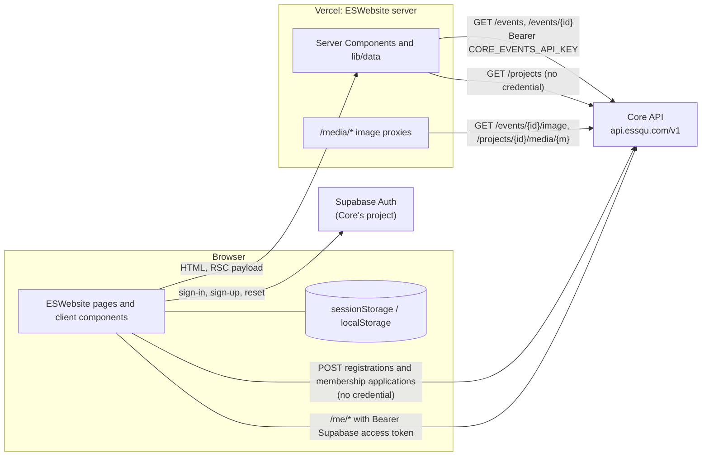

# Architecture

## Purpose and boundaries

ESWebsite presents the Engineering Society to the public and gives members a self-service front
door. Its responsibilities:

- the landing page, archive, disciplines, leadership and about pages, from content files;
- published events and event registration, from Core;
- the membership application (five categories, any valid email, no ID card since Core ADR 0025),
  sent to Core, and SQU student verification from the profile;
- member sign-in, email confirmation and password reset, through Supabase Auth in the browser;
- the signed-in member's profile, own registrations, attendance check-in and project
  submissions, through Core;
- published projects, from Core.

What it does **not** do (**Source**):

- It has no database, no Supabase service key, no API routes and no server actions. A search for
  `'use server'` finds nothing.
- It does not decide capacity, waitlists, duplicates, membership, roles or permissions. Core
  decides all of them, and the site shows Core's answer.
- It does not review applications or manage events. That happens in Core's dashboard.

## Technology

| Concern       | Choice                                                                                          |
| ------------- | ----------------------------------------------------------------------------------------------- |
| Framework     | Next.js 16.3.8, App Router, React Server Components, Turbopack builds                           |
| Language      | TypeScript 5.9 (`strict` settings in `tsconfig.json`)                                           |
| Styling       | CSS Modules plus global tokens (`styles/tokens.css`, `styles/globals.css`); no Tailwind         |
| Motion and 3D | GSAP with `@gsap/react`; Three.js through `@react-three/fiber` and `@react-three/drei`          |
| Auth client   | `@supabase/supabase-js` in the browser only                                                     |
| Tests         | Node's built-in test runner with a TypeScript loader (`tests/support/register.mjs`)             |
| Hosting       | Vercel project `essqu-web` (**Inferred** from repository documents; settings not readable here) |

## Directory map

```text
app/                    App Router: root layout, homepage, not-found, dev-only pages
app/(platform)/         Every page except the homepage, sharing the navbar, footer and demo session
app/media/              The only route handlers: same-origin image proxies to Core
components/             UI: layout (navbar, account menu, footer), sections (homepage),
                        pages/<route>/ (page-specific components), discovery, platform, three, ui
config/site-features.json  Developer-controlled page and profile switches
content/                Bilingual content files; content/platform/ holds the prototype sample records
lib/core-api/           The only code that talks to Core (server reads and browser calls)
lib/member-auth/        Supabase Auth client, session store, link parsing, return paths
lib/data/               Page-facing data layer: Core-backed events and projects, sample records
lib/i18n/               Locale config, dictionaries (English and Arabic), server helper
lib/security-headers.ts Response headers used by next.config.ts
lib/site-features.ts    Parses and validates config/site-features.json
public/                 Images, hero stills, media
styles/                 Tokens and global CSS
tests/                  Unit tests (core-api, data, member-auth, security)
integration/            Dated integration reports (history)
```

## System context



The server sends Core's public base URL and the public Supabase URL and anon key to the pages as
props. Server-side event reads carry the `events:read` key. Every other Core call goes from the
browser, so Core sees the visitor's own IP address for rate limiting and the visitor's own token
for identity.

## Routing and layouts

- [`app/layout.tsx`](../../app/layout.tsx) is the root layout. It loads three Google fonts through
  `next/font` (downloaded at build time), sets `lang` and `dir` from the locale cookie, and wraps
  the site in `I18nProvider` and `MemberAccountProvider`. The account provider receives
  `getMemberAuthConfig()` and `getRegistrationBaseUrl()`, so the navbar's account state depends on
  the same variables as sign-in.
- [`app/page.tsx`](../../app/page.tsx) is the homepage. It renders its own header and footer.
- [`app/(platform)/layout.tsx`](<../../app/(platform)/layout.tsx>) wraps every other page in the
  navbar, footer and `DemoSessionProvider`. `loading.tsx` shows a skeleton during navigation.
  Deep routes have their own `not-found.tsx`.
- Route handlers exist only under [`app/media/`](../../app/media/). There is no `middleware.ts` or
  `proxy.ts`.
- [`lib/routes.ts`](../../lib/routes.ts) builds every internal URL, so a record has one address
  everywhere.

The full route inventory is in [Routes](../reference/routes.md).

## Rendering, data fetching and caching

- **Dynamic rendering.** The root layout reads the `es-locale` cookie through `getI18n()`, so pages
  render per request rather than being prerendered. Some pages also set
  `export const dynamic = 'force-dynamic'`: `/profile`, `/projects/submit`,
  `/events/[slug]/attendance` and both media routes.
- **The data layer.** Pages read through [`lib/data/index.ts`](../../lib/data/index.ts).
  `getHomeEvents`, `getEventsTimeline` and `getEventPage` read Core events. `getProjects` and
  `getProject` read Core's published projects. The other functions return sample records from
  `content/platform/`.
- **Event reads** ([`lib/core-api/client.server.ts`](../../lib/core-api/client.server.ts)):
  - a 4-second timeout by default;
  - one retry after 300 ms on a 5xx response or a dropped connection, never on 401, 403 or a
    timeout;
  - responses cached in the Next.js data cache for 30 seconds by default, tagged `core-events` and
    `core-event:{id}`.

  Nothing in the repository calls `revalidateTag`, so cached events expire by time only.
  `react.cache` deduplicates calls within one request.

- **Project reads** ([`lib/core-api/projects.server.ts`](../../lib/core-api/projects.server.ts))
  use `cache: 'no-store'` and reject redirects, because Core's projects contract requires an
  unpublished project to disappear immediately. A malformed page fails the whole catalogue
  closed: an empty list is valid, a partial list is never shown.
- **Private data** (profile, own registrations, project drafts) is fetched in the browser with
  the member's token, never on the website server.
- **Images.** `/media/events/{id}` and `/media/projects/{id}/{media}` proxy Core images so the
  pages can use `next/image` on the site's own origin. Event covers with a version parameter are
  cached by the CDN for five minutes; project images are `no-store`.

## Server and client boundaries

| Server-only (`import 'server-only'`)                                           | Browser                                                                                                           |
| ------------------------------------------------------------------------------ | ----------------------------------------------------------------------------------------------------------------- |
| `lib/core-api/config.server.ts`: reads and validates the Core variables        | `lib/core-api/registration.ts`: guest event registration                                                          |
| `lib/core-api/client.server.ts`: the only server-side HTTP call to Core        | `lib/core-api/membership.ts`: membership application and status                                                   |
| `lib/core-api/events.server.ts`: event list and detail                         | `lib/core-api/member-events.ts`, `member-profile.ts`, `member-projects.ts`: `/me/*` calls with the member's token |
| `lib/core-api/projects.server.ts`: published projects                          | `lib/member-auth/client.ts`, `account.tsx`, `links.ts`: Supabase Auth and the session                             |
| `lib/member-auth/config.server.ts`: reads and validates the Supabase variables |                                                                                                                   |

`CORE_EVENTS_API_KEY` is read only in `config.server.ts` and sent only from `client.server.ts`.
The browser receives `CORE_API_BASE_URL`, `SUPABASE_URL` and `SUPABASE_ANON_KEY` as props. All
three are public by design. The project deliberately uses no `NEXT_PUBLIC_` variables, so these
values can change without a rebuild, except where the security headers use them (see
[Configuration](../reference/configuration.md#build-time-versus-runtime)).

## State

| State                        | Where it lives                                                                                                           |
| ---------------------------- | ------------------------------------------------------------------------------------------------------------------------ |
| Supabase session             | `sessionStorage` by default, `localStorage` with "Keep me signed in"; key `es-member-auth` (`lib/member-auth/client.ts`) |
| Signed-in account summary    | In-memory store with `useSyncExternalStore`, plus a non-secret summary cached in `sessionStorage` (`es-member-summary`)  |
| Membership status token      | `localStorage` key `es-membership-application`; never in a URL                                                           |
| Check-in code from a QR scan | `sessionStorage`, for at most three minutes                                                                              |
| Prototype demo session       | `sessionStorage` (`components/platform/DemoSession.tsx`): sample registrations and mentorship requests in this tab only  |
| Language                     | Cookie `es-locale` (one year) plus `localStorage`                                                                        |
| Listing filters              | The URL query string                                                                                                     |

The website sets no authentication cookie and keeps no server session.

## Localization and right-to-left layout

- Locales are `en` (default) and `ar` ([`lib/i18n/config.ts`](../../lib/i18n/config.ts)). The server
  reads the `es-locale` cookie, so a returning Arabic visitor gets Arabic, right-to-left HTML with
  no flash.
- Switching language sets the cookie and calls `router.refresh()`, without a full reload
  ([`components/i18n/I18nProvider.tsx`](../../components/i18n/I18nProvider.tsx)).
- Interface copy is in `lib/i18n/dictionaries/`:
  - `en.ts` and `ar.ts`;
  - `platform-en.ts` and `platform-ar.ts`;
  - `pages/*.ts`, where each file holds both languages.

  The Arabic dictionaries are typed against the English ones, so a missing translation fails the
  type check. Content files carry `{ en, ar }` fields.

- Server Components use `await getI18n()`. Client Components use `useI18n()`. Both return
  `{ t, l, locale, dir, intl }`.
- Arabic uses IBM Plex Sans Arabic and Western digits (`ar-OM-u-nu-latn`). The layout uses
  logical CSS properties, and direction-dependent motion follows `dir`.
- Core content (event titles, descriptions) is single-language. Project content carries both
  languages, and an empty language falls back to the other
  ([`lib/core-api/projects-public.ts`](../../lib/core-api/projects-public.ts)).

## Feature flags

[`config/site-features.json`](../../config/site-features.json) is the only switchboard. It is
parsed at build time by [`lib/site-features.ts`](../../lib/site-features.ts), and a typo fails the
build.

- `pages.<id>` is `active` or `coming-soon`, for `projects`, `events`, `register`, `profile`,
  `members`, `network` and `certificates`. [`content/site.ts`](../../content/site.ts) derives
  `COMING_SOON` from it, and each page checks `isComingSoon(id)` before rendering.
- `profile.allowPhotoUpload` and `profile.allowProfileEditing` hide controls. Core enforces its
  own matching switches (`MEMBER_PHOTO_UPLOADS`, `MEMBER_PROFILE_EDITING`). A control shows only
  when both allow it ([`lib/core-api/member-profile.ts`](../../lib/core-api/member-profile.ts),
  `profileControls`).

Current values: projects, events, register and profile are `active`; members, network and
certificates are `coming-soon`; both profile switches are `true`. Changing them needs a commit and
a redeploy. There is no dashboard or database setting.

## Real features versus prototypes

| Area                                                           | State (**Source**)                                                               |
| -------------------------------------------------------------- | -------------------------------------------------------------------------------- |
| Events (homepage section, `/events`, `/events/[slug]`)         | Real, from Core. Without Core they show an "unavailable" state, never samples.   |
| Event registration (guest and member)                          | Real, sent to Core                                                               |
| Attendance check-in (`/events/[slug]/attendance`)              | Real, sent to Core                                                               |
| Membership application (`/register`)                           | Real, sent to Core (no ID card since Core ADR 0025)                              |
| Sign-in, confirmation, password reset                          | Real, Supabase Auth                                                              |
| Member profile (`/profile`)                                    | Real, from Core                                                                  |
| Projects catalogue and detail                                  | Real, from Core's published snapshots                                            |
| Project submission (`/projects/submit`)                        | Real, through Core's member project API                                          |
| Homepage projects section                                      | Static content from `content/projects.ts` (the society's posters), not Core      |
| Society figures on the homepage                                | Demonstration values, labelled as such (`content/stats.ts`)                      |
| `/members`, `/network`, `/certificates` and their detail pages | Coming Soon; the full prototypes remain behind the switch and use sample records |
| `/about` yearly record, `/disciplines` member network          | Sample figures and sample members                                                |
| Archive (`/activities`), leadership, disciplines content       | Content files                                                                    |

## Security headers

[`lib/security-headers.ts`](../../lib/security-headers.ts) supplies the headers that
`next.config.ts` sets on every page:

- **Enforced:** `frame-ancestors 'none'`, `base-uri 'self'`, `object-src 'none'`,
  `form-action 'self'`, `X-Frame-Options: DENY`, `nosniff`, a referrer policy and a permissions
  policy.
- **Report-only:** a full content security policy. Its `connect-src` lists the origins of
  `CORE_API_BASE_URL` and `SUPABASE_URL`.
- **Sign-in and private pages** (`/login`, `/forgot-password`, `/reset-password`,
  `/events/:slug/attendance`, `/projects/submit`, `/profile`) also send `no-referrer` and
  `no-store`.

Next.js computes these headers at build time. **Tests:** `tests/security/headers.test.ts`.
