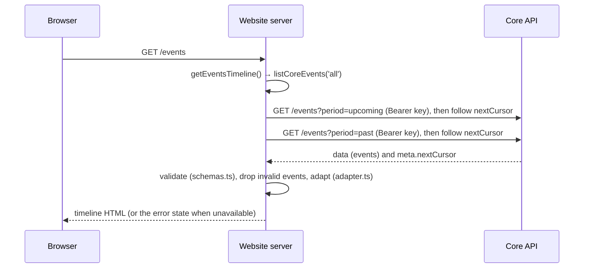
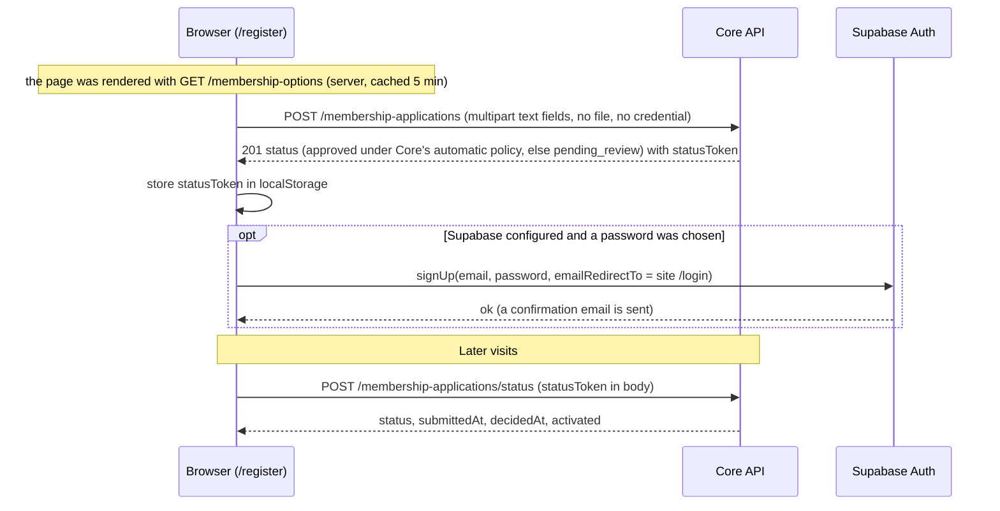

# Workflows

How each user-facing action travels from the UI to Core or Supabase and back. Core is the
authority for every rule mentioned here. The website validates input only to help the visitor
and validates Core's answers before rendering them. Endpoint details are in Core's
[API reference](https://github.com/EngCrafters/engsoc-platform/blob/main/docs/reference/api.md).
Core's side of the same flows is in its
[workflows](https://github.com/EngCrafters/engsoc-platform/blob/main/docs/explanation/workflows.md).

## Reading events

- **Paging.** Up to five pages of 20 per period. A list still truncated after five pages is
  logged (`truncatedAfterPages`). An event that moved from upcoming to past between two cached
  pages appears once.
- **Unavailable.** A Core failure, a missing configuration or an invalid envelope makes the
  result `unavailable`. The page shows an error state with a retry link and the rest of the site
  keeps rendering. No sample events are substituted.
- **Fields.** Core does not publish an event type, end time, capacity counts, programme,
  disciplines or Arabic text, so those parts of the design stay hidden
  ([`lib/core-api/adapter.ts`](../../lib/core-api/adapter.ts)). `availability` (`open`,
  `waitlist`, `closed`), `coverImageUrl` and `phoneRequired` drive the registration panel.
- **Descriptions** render plain text with safe HTTP(S) links, without evaluating HTML
  ([`lib/event-description.ts`](../../lib/event-description.ts)).

## Event registration

The registration panel is [`components/pages/events/RegistrationPanel.tsx`](../../components/pages/events/RegistrationPanel.tsx).
It picks one of two paths.

### Guest (no member session)

1. The visitor enters a name (1–200 characters, no control characters) and an email (at most
   254 characters). `validateRegistration` mirrors Core's limits.
2. If the event has `phoneRequired`, a phone in international format is required
   (`+` followed by 7 to 15 digits; `normalizePhone`).
3. The browser sends `POST {CORE_API_BASE_URL}/events/{id}/registrations` with
   `{attendeeName, attendeeEmail, intent, attendeePhone?}`, `credentials: 'omit'`, a 15-second
   timeout and a fresh `X-Request-Id` ([`lib/core-api/registration.ts`](../../lib/core-api/registration.ts)).
4. Core's answer becomes an outcome:

| Core answer                               | Outcome shown                                                                                                                                                                                                                            |
| ----------------------------------------- | ---------------------------------------------------------------------------------------------------------------------------------------------------------------------------------------------------------------------------------------- |
| 201 `{data:{status:"confirmed"}}`         | Confirmed                                                                                                                                                                                                                                |
| 201 `{data:{status:"waitlisted"}}`        | On the waitlist                                                                                                                                                                                                                          |
| 409 with `reason`                         | `event-full` turns the dialog into the waitlist dialog (joined only by a second explicit submit); `registration-available` returns to registering; `registration-closed`, `already-registered` and `already-waitlisted` are said plainly |
| 422 naming `attendeePhone`                | Phone required                                                                                                                                                                                                                           |
| 422 naming other fields                   | Field errors                                                                                                                                                                                                                             |
| 404                                       | The event is no longer public                                                                                                                                                                                                            |
| 429 with `Retry-After`                    | Rate limited. A resubmit inside the window is answered locally without sending.                                                                                                                                                          |
| 503, timeout, CORS refusal, anything else | "Can't be done right now"                                                                                                                                                                                                                |

A registration is never retried automatically: a second POST would be a duplicate.

### Signed-in member

The panel loads `GET /me/events/{id}/attendance` with the member's access token to get the
verified profile and any existing registration.

1. If the event needs a phone and the profile has none, the member enters one. The panel saves it
   first with `PATCH /me/profile {phone}`.
2. The browser sends `POST /me/events/{id}/registrations {intent}`. There is no name or email in
   the body, because Core takes identity from the token.
3. Core answers 201 with `confirmed` or `waitlisted`, or a problem whose `errors[0].code` is a
   domain code. The panel maps the codes `ALREADY_REGISTERED`, `ALREADY_WAITLISTED`, `EVENT_FULL`,
   `REGISTRATION_CLOSED`, `REGISTRATION_AVAILABLE` and `PHONE_REQUIRED` to the same messages as
   the guest path.
4. **Approval during a session.** If Core answers `403 MEMBER_REQUIRED` while the person was
   approved during a long-lived session, `fetchMemberEvent` calls `GET /me/membership` once. That
   call completes Core's activation, and the panel retries
   ([`lib/core-api/member-events.ts`](../../lib/core-api/member-events.ts)).

A signed-in person who is not a member can still choose the guest path explicitly. The website
never switches to guest mode silently when membership infrastructure is missing.

## Membership application and account

- **Form** ([`components/pages/register/RegisterForm.tsx`](../../components/pages/register/RegisterForm.tsx),
  [`lib/core-api/membership.ts`](../../lib/core-api/membership.ts)):
  - full name, any valid email address, a category, a discipline, up to four interests and
    consent (version `2026-11-v2`);
  - by category (Core's `GET /membership-options` decides):
    - a University Student gives a university (listed, or "Other" with its name) and an
      academic year;
    - a Graduate may give an alma mater;
    - other categories give neither;
    - fields of a previous category are cleared when the category changes and never sent
      (`membershipFormData`);
  - no student ID and no ID card (Core ADR 0025). SQU students verify later, from `/profile`;
  - one request through `XMLHttpRequest` with a 90-second timeout, never retried. Without Core's
    options no form is shown: the page says it couldn’t be loaded and offers Try again, which
    reads `GET /membership-options` again from the browser.
- **Outcomes:**
  - 201 with `status: approved` (Core's `automatic` policy, Core ADR 0029) shows "Welcome to the
    society": the membership is approved and becomes active when the email is confirmed;
  - 201 with `status: pending_review` shows "Application received" with next steps;
  - 409 `already-applied` or `already-member` shows a notice;
  - 422 maps field errors onto the form;
  - 429 shows the rate limit (Core allows five per client address per hour);
  - anything else shows "couldn't be sent just now, nothing was saved".
- **Password.** When `SUPABASE_URL` and `SUPABASE_ANON_KEY` are set, the form asks for a password
  (8 characters to 72 bytes; [`lib/member-auth/password.ts`](../../lib/member-auth/password.ts)).
  The password goes only to Supabase Auth, after Core accepted the application. If sign-up fails,
  the application stays and the confirmation screen offers "Set up sign-in" to retry. Without the
  Supabase variables, the form has no password fields and the applicant gets Core's invitation
  after approval.
- **Status.** The 256-bit status token is the applicant's only handle. It is sent in a request
  body, never a URL. Returning visitors see "under review" or "approved", or a short note above a
  fresh form after a rejection.
- **Wording follows Core's policy.** `GET /membership-options` says `approval: automatic` or
  `review`; the note above the form ("Membership starts when you register." or "Every application
  is reviewed.") and the duplicate notice follow it. Only wording: Core decides at submission.
- **Membership starts in Core.** Under the automatic policy Core approves a valid application at
  submission, and the member record is created at the first confirmed sign-in (the confirmation
  link lands on `/login`, which calls `GET /v1/me/membership`). Otherwise it follows review and
  activation. Being signed in grants nothing by itself.
- **Account activation** (Core ADR 0030), a separate Core setting the 201 reports as
  `accountActivation`. `email_confirmation` (the default): Supabase sign-up and its confirmation
  email, as above. `immediate`: no email; the browser sends its status token to
  `POST /membership-applications/account`, Core creates the account and returns a one-time sign-in
  token, and the browser signs in with it (`verifyOtp`) and sets the chosen password with Supabase
  Auth (`updateUser`) ([`lib/member-auth/client.ts`](../../lib/member-auth/client.ts)
  `signInWithAccountToken`). The page then shows "You're signed in" and Open your profile. An
  address that already has an account gets "sign in with its password"; if Core cannot create
  accounts (`409 confirmation-required` or `503 not-configured`), the page falls back to email
  confirmation.

## Sign-in, confirmation and sign-out

[`components/pages/account/LoginView.tsx`](../../components/pages/account/LoginView.tsx):

1. The server passes `getMemberAuthConfig()`. **If it is `null`, the page shows "Sign-in isn't
   available right now. Please try again later." and renders no form.** This is the only place
   that message appears. It happens before anything is submitted, and only when `SUPABASE_URL` or
   `SUPABASE_ANON_KEY` is missing or invalid on the server (see
   [Configuration](../reference/configuration.md#supabase_url-and-supabase_anon_key)).
2. Otherwise the page starts in a "checking" state. It reads any Auth link in the address:
   `?token_hash=…&type=…`, a `#access_token=…` fragment or a Supabase error. It removes the link
   from the address bar and history, then verifies it (`verifyOtp` or `setSession`).
3. Without a link, it uses the stored session. With no session, it shows the form.
4. **Submit.** `signInWithPassword` runs in the browser.
   - Failures are classified without telling "no account" from "wrong password":
     invalid credentials, email not confirmed (with a "resend confirmation" action), disabled,
     rate limited, or "Sign-in couldn't be completed. Check your connection and try again."
   - "Keep me signed in" chooses `localStorage` over `sessionStorage`.
5. **Membership status.** After sign-in the page calls `GET /me/membership` with the access token.
   - It shows member, applicant stage, unconfirmed or none.
   - A `401` signs the browser out locally and shows the form again.
   - With a valid `?next=` and an approved member, it navigates there.
   - If Core cannot answer, it shows "Your membership status couldn't be loaded right now".
6. **Sign-out** (account menu or status view) calls `signOut({ scope: 'local' })` and clears the
   cached summary.

The account menu ([`lib/member-auth/account.tsx`](../../lib/member-auth/account.tsx)) draws its
state from the stored session first, then confirms with Supabase and Core. It follows sign-in,
token refresh, sign-out and other tabs.

## Password reset

1. `/forgot-password` calls `resetPasswordForEmail(email, { redirectTo: <site>/reset-password })`.
   The answer is the same for every address. Rate limits and outages have their own messages.
2. The email link must use Core's documented token-hash template:
   `{{ .RedirectTo }}?token_hash={{ .TokenHash }}&type=recovery`.
3. `/reset-password` shows the form only after it has verified a **recovery** link in this page
   load (`verifyOtp` or `setSession`). An ordinary session, or an email or user ID in the URL,
   cannot change a password.
4. `updateUser({ password })`, then `signOut({ scope: 'global' })` (falling back to local), then
   a link back to sign-in.

`/profile` settings also offer "send reset email" and an email change
(`updateUser({ email }, { emailRedirectTo: <site>/login })`)
([`components/pages/profile/AccountSettings.tsx`](../../components/pages/profile/AccountSettings.tsx)).
Core adopts a confirmed new sign-in email as the member's email if no other member uses it (any
valid address since Core ADR 0025; previously only SQU addresses).

## Member profile

[`components/pages/profile/MemberProfile.tsx`](../../components/pages/profile/MemberProfile.tsx)
loads, in parallel:

- `GET /me/profile`;
- `GET /me/events`;
- when projects are active, `GET /me/projects`.

| Action                                  | Request                                                          | Rules (website check; Core checks again)                                                                                                                                          |
| ------------------------------------------------------------- | -------------------------------------------------------------------------------------------------------- | ------------------------------------------------------------------------------------------------------------------------------------------------------------------------------------------------------------------------------------------------------------------------ |
| Edit phone, category, university, year, discipline, interests | `PATCH /me/profile {phone, category, institution, institutionName, academicYear, discipline, interests}` | The registration rules for the category (`draftProblems`, `editOf`); year 1–5 for students only; a known discipline; at most 4 distinct known interests; phone empty or international. Hidden unless both the site switch and Core's `features.profileEditing` allow it. |
| Upload or replace photo                 | `PUT /me/profile/photo` with the raw JPEG or PNG body            | At most 3 MiB; Core re-encodes. Hidden unless both switches allow it.                                                                                                             |
| Remove photo                            | `DELETE /me/profile/photo`                                       | Always allowed                                                                                                                                                                    |
| Correct name (or a legacy student ID)                         | `POST /me/profile/changes {field, value}`                        | `full_name` 2–200 characters; `university_id` 6–10 digits, offered only to members whose record has one (the earlier SQU-only form). A membership reviewer decides it in Core's dashboard.                                                                  |

Results are validated before rendering: `toOwnProfile` drops unknown disciplines and interests.
`401` sends the visitor to sign in, `403 MEMBER_REQUIRED` shows the non-member state, and `503`
shows a retry.

### SQU verification and committee leadership (Core ADR 0025)

Two independent cards on `/profile`, each with its own loading, error (Core's request reference
and Try again) and empty state:

- [`SquVerificationCard.tsx`](../../components/pages/profile/SquVerificationCard.tsx)
  (`#squ-verification`) loads `GET /me/verification`;
- [`LeadershipCard.tsx`](../../components/pages/profile/LeadershipCard.tsx) (`#leadership`) loads
  `GET /me/leadership` and shows dashboard access as a separate, read-only fact.

| Action                        | Request                                                                                                                           | Rules (website check; Core checks again)                                                                                                                                                                                                                                                                                                                                                                                                                      |
| ----------------------------- | --------------------------------------------------------------------------------------------------------------------------------- | ------------------------------------------------------------------------------------------------------------------------------------------------------------------------------------------------------------------------------------------------------------------------------------------------------------------------------------------------------------------------------------------------------------------------------------------------------------- |
| Submit SQU verification       | `POST /me/verification/squ` (multipart `studentNumber`, `document`)                                                               | Number of 6–10 digits; a JPEG, PNG, WebP or PDF prepared by `prepareDocument` (photos re-encoded without metadata). Offered while Core's `canSubmit` is true; otherwise the next date is shown.                                                                                                                                                                                                                                                               |
| Request a leadership position | `GET /me/leadership/options`, then `POST /me/leadership/requests {committeeId, teamId (null for committee leadership), position}` | A committee; the assignment level (Committee leadership, or Team leadership when the committee has active teams); a team for team leadership only; then Chief or Assistant Chief. Changing the committee clears the level and team; changing the level clears the team. Hidden, with a "requests are closed" note, while Core reports `requestsOpen: false`. Core re-checks the switch, the path, duplicates and limits (`REQUESTS_CLOSED` 409 and the rest). |

`toSquState`, `toOwnLeadership` and `toLeadershipOptions` drop anything malformed. The cards never receive a
reviewer note, a reviewer's identity, a document key or the full student number. Decisions
appear on the next visit; no email is sent. A Chief or Assistant Chief appointment gives
dashboard access only through the permissions assigned to its committee or team (Core ADR 0027);
the leadership card shows which positions do.

**Email announcements** (Core ADR 0028). The profile's Account settings include an "Email
announcements" switch (`EmailPreferences.tsx`): `GET /me/email-preferences` loads the choice and
`PATCH /me/email-preferences {announcements}` saves it. Unsubscribe links in the society's emails
change the same setting in Core. Membership is unaffected either way.

## Project submission

[`components/pages/projects/ProjectSubmission.tsx`](../../components/pages/projects/ProjectSubmission.tsx)
and [`lib/core-api/member-projects.ts`](../../lib/core-api/member-projects.ts):

1. List own projects: `GET /me/projects?offset=n`, 30 per page.
2. Create: `POST /me/projects {operation:"create", content}`. Save:
   `PATCH /me/projects/{id} {operation:"save", revision, content}`. Submit:
   `PATCH … {operation:"submit", revision}`. A stale revision returns 409.
3. Images: `POST /me/projects/{id}/media` with a raw JPEG or PNG of at most 3 MiB, and
   `DELETE /me/projects/{id}/media/{media}`. The working revision selects up to 6 images
   (`content.mediaIds`).
4. A project is editable when the member is the author and it is a draft, rejected, changes
   requested, or the approved and published revision (`canEditProject`). Submitted and
   under-review revisions are locked.
5. Review, approval and publication happen in Core's dashboard. The member follows decisions in
   the project's history.

Content is validated against a strict schema on both sides
([`lib/core-api/projects.ts`](../../lib/core-api/projects.ts), `isProjectContent`). Either
language completes a text field.

## Attendance check-in

1. Organizers show a QR code in Core's dashboard. It opens
   `<PUBLIC_WEBSITE_ORIGIN>/events/{id}/attendance#checkin=<64 hex>`.
2. [`AttendanceConfirmation.tsx`](../../components/pages/events/AttendanceConfirmation.tsx) reads
   the fragment and removes it from history. It keeps the code in `sessionStorage` for at most
   three minutes, so it survives a sign-in round trip.
3. Not signed in: it goes to `/login?next=/events/{id}/attendance` and comes back.
4. It loads `GET /me/events/{id}/attendance` (profile, registration, `checkinOpen`, `closesAt`).
5. Only an explicit button press sends `POST /me/events/{id}/attendance {challenge}`. Loading the
   page never records attendance.
6. Core answers with `checkedInAt`, or `NOT_REGISTERED`, `WAITLISTED`, `CHECKIN_CLOSED`,
   `CHALLENGE_EXPIRED` or `INVALID_CHALLENGE`. Repeating the request returns the original time.

## Loading, validation and error conventions

- **Loading.** `app/(platform)/loading.tsx` shows a skeleton during navigation. Client flows show
  a "checking" state until Supabase and Core answer.
- **Validation.** Client checks mirror Core's limits. Core's 422 `errors[]` are mapped onto fields.
  Unknown answers are treated as unavailable.
- **Errors never reveal internals.** No provider message, status or token is shown. Messages exist
  in English and Arabic (`lib/i18n/dictionaries/pages/*.ts`).
- **Authorization.** `401` means the session is missing or expired. The UI signs out locally or
  offers sign-in. `403 MEMBER_REQUIRED` or `EMAIL_UNCONFIRMED` means the account is not an active
  member. Hiding a control is never the security boundary.
